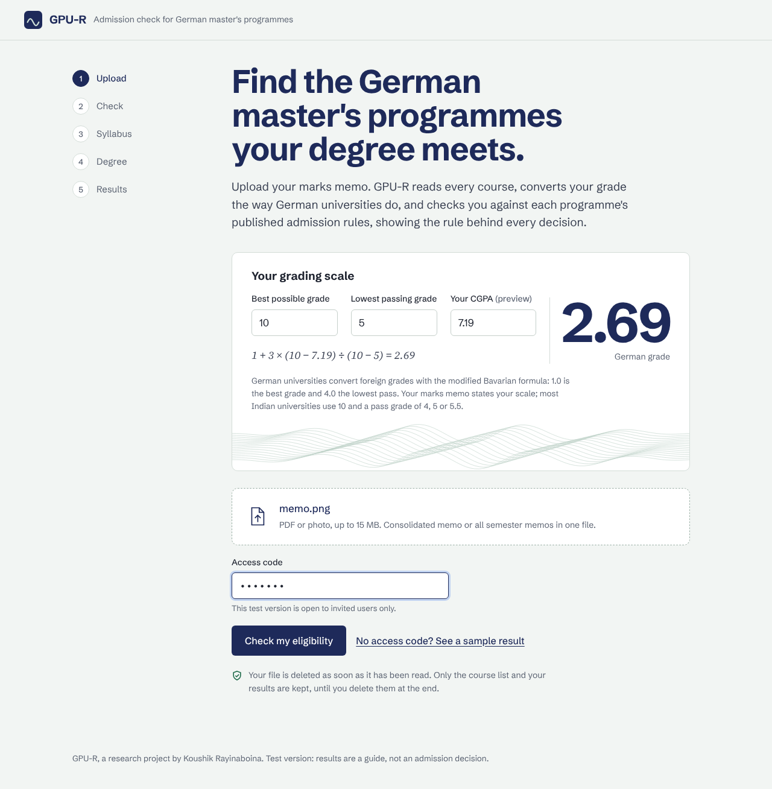
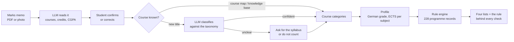
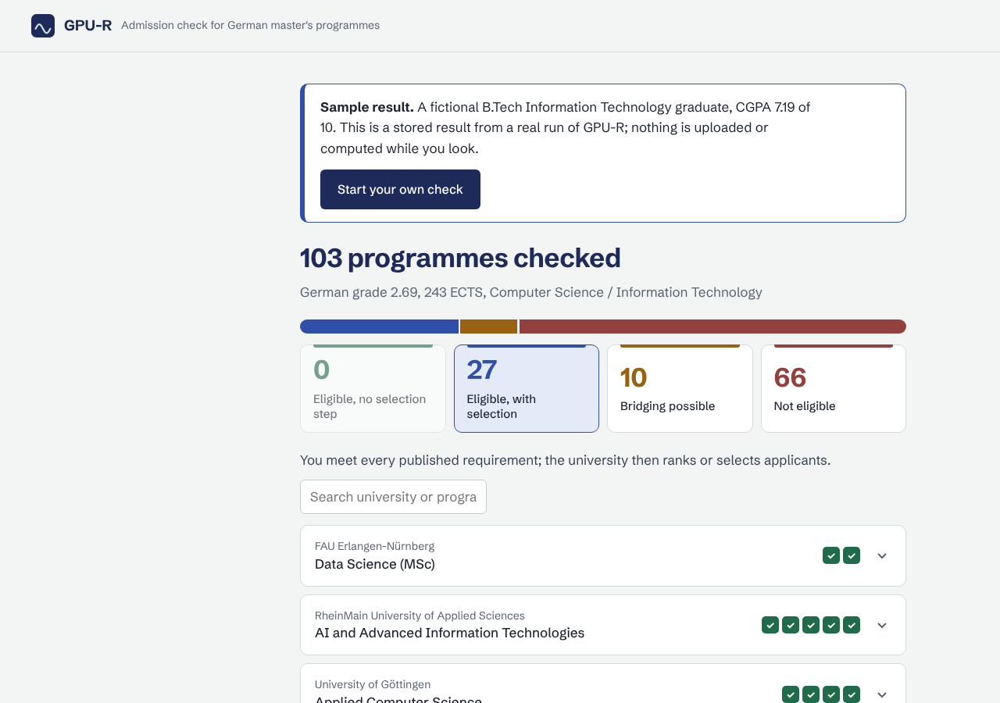
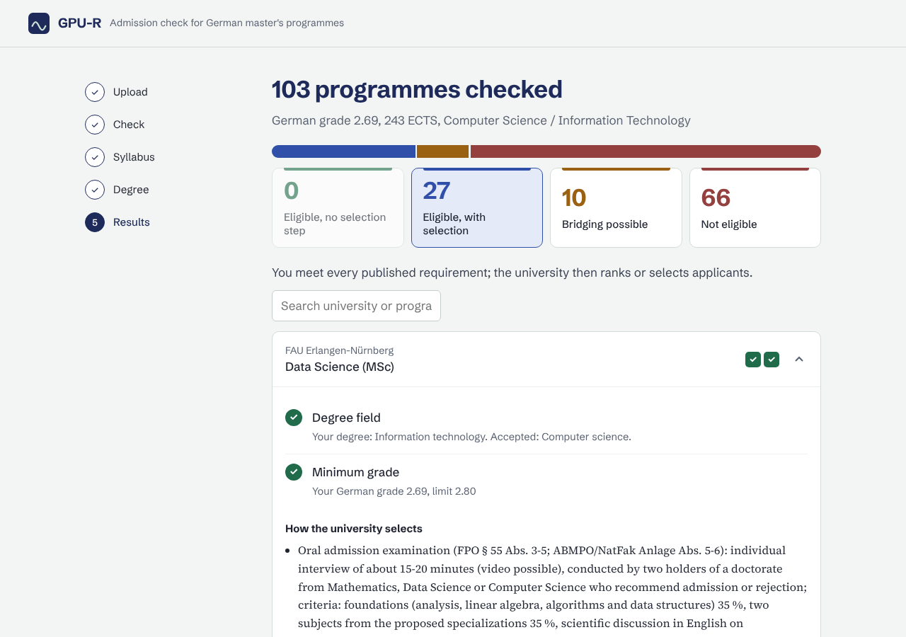

# GPU-R: admission eligibility engine for German master's programmes

GPU-R reads an Indian bachelor's marks memo and checks the student against the published admission rules of German master's programmes. **An LLM reads the document and classifies the courses; fixed rules make every eligibility decision.** Unclear courses are never guessed: the student is asked for the syllabus instead.

**Live demo:** [gpu-r-api.onrender.com](https://gpu-r-api.onrender.com), click *"See a sample result"* (no login; a fictional student). The free server sleeps when idle, so the first load can take up to a minute.

**Demo video** (a real marks memo, shared with the owner's consent, name hidden):


https://github.com/user-attachments/assets/04d34fb5-2c87-488f-ab57-196264c0a4c9




## Why

Indian students applying for German master's programmes have to compare their transcript with dozens of regulations, each with its own subject minimums (for example "at least 30 ECTS in mathematics"), grade limits and conditions. Mistakes are expensive: a wrong application costs a fee and a semester; a missed programme is a lost chance. GPU-R does this check in about three minutes and shows the rule behind every decision.

## How it works



| Step | What happens | AI? |
|---|---|---|
| Reading | Vision LLM extracts courses, credits, grades, CGPA into a validated schema; the student confirms | yes, reads only |
| Classification | Known course titles come from an approved course map and a knowledge base; new titles are classified by the LLM against a fixed taxonomy; low confidence means "ask for the syllabus", never a guess | yes, classifies only |
| Conversion | CGPA to German grade with the modified Bavarian formula; credits to ECTS from the memo's own totals (lateral entry handled) | no |
| Decision | Each programme's rules (degree field, grade limit, subject minimums, conditions caps) are checked by plain Python | **no** |

The result is four lists: eligible with no selection step, eligible with selection, bridging possible (a gap the regulation lets you close after admission), and not eligible, each with the courses used and the regulation's wording.



## Results

Evaluated on 18 synthetic transcripts built from the real curricula of 15 Indian universities (4 fields, regular and lateral entry), each with a hand-checked answer key. Latest run per transcript, November 2026:

| Measure | All 18 | 4 held-out (never used for fixes) |
|---|---|---|
| Courses found on the memo | 1,051 of 1,051 | 206 of 206 |
| CGPA and credits read correctly | 18 of 18 | 4 of 4 |
| Courses classified correctly | 94.4% | 93.6% |
| Classified wrongly | 1.5% | 1.6% |
| Not counted (syllabus asked instead of a guess) | 4.0% | 4.8% |
| Programme decisions identical to the answer key | 98.6% (1,023 of 1,037) | 100% (205 of 205) |
| **Decisions wrongly in the student's favour** | **0** | **0** |

All 14 differing decisions were stricter than the answer key, never looser. Cost is about $0.39 and 66 seconds of model time per student; known course titles are answered from the knowledge base for free. The evaluation harness, the sample specifications and the answer keys are in `tools/` and `tests/synthetic/`.

## Data and its provenance

The programme list comes from the DAAD International Programmes database, filtered by fixed scope rules: master's programmes in computer science, electrical/electronic, mechanical and civil engineering; English-taught; no tuition fees; not online; not excluding Indian bachelor's degrees.

Every one of the 228 programme records was rebuilt from the programme's **binding admission and examination regulations, including amendments**, with a quote and a source link for each requirement. Extraction was done with an AI research agent; each batch was re-checked independently, then reviewed and approved by me before merging. The records are frozen with SHA-256 checksums and validated against a Pydantic schema in CI (`scripts/validate_records.py`). An audit before the rebuild found that most old records had no source and some had invented limits, which is why nothing enters the data without a source quote.

Regulations change during the year. A weekly monitoring agent watches the regulation pages of the programmes and reports new amendments and broken links for review; it never edits the data. See [docs/regulation-tracker.md](docs/regulation-tracker.md).

## Design decisions

- **AI reads, rules decide.** Eligibility must be repeatable and explainable, so the model never makes or influences a verdict.
- **Never guess.** A course whose title does not say what it teaches is not counted until a syllabus shows it. Results can only get stricter, never wrongly positive.
- **Count subjects the way the regulation names them.** Categories are the subject areas regulations use, so totals compare one to one.
- **Labs follow their theory course**, so a lab never adds a subject the student did not study.
- **Cache what is known.** An approved course map (553 titles) and a reviewed knowledge base (606 entries) answer repeat titles without a model call.
- **Privacy by default.** Uploaded files are deleted right after reading; a session's data can be deleted by the student; nothing is used for training.



## Repository layout

```
api/            FastAPI service: sessions, upload, confirm, syllabus, eligibility, report, demo
web/            the student website (one page, no framework, self-hosted fonts)
pipeline/       reading, classification, knowledge base, lab rule, profile building
gpur/           record schema (Pydantic) and the rule engine
engine_kit/     engine configuration and rule tests
data/frozen/    the 228 programme records, frozen with checksums
data/taxonomy/  subject taxonomy (master + 4 field files) and the approved course map
data/knowledge/ reviewed knowledge-base seed
tools/          evaluation harness: synthetic transcripts, batch runner, evaluation log
tests/          unit tests, answer keys, synthetic sample specifications and labels
docs/           regulation tracker, images
```

## Run locally

```
python -m pip install -r requirements-dev.txt
cp .env.example .env          # add your OpenAI key and an access code
python -m pytest -q           # 140+ tests; no API key needed (the AI is faked in tests)
uvicorn api.main:app --reload # then open http://127.0.0.1:8000
```

Record checks: `python scripts/validate_records.py --data data/frozen --taxonomy data/taxonomy/GPU-R_taxonomy_master.json`

## Limits and next steps

- Covers DAAD-listed, English-taught, tuition-free programmes in four fields. Adding a field is data work; the pipeline stays the same.
- Evaluation uses synthetic transcripts based on real curricula plus a few real memos tested by hand; a larger real-transcript test needs consent and secure storage first.
- Selection steps (aptitude tests, ranking points) are shown as information, not scored.
- Before real users: EU storage with automatic deletion, a privacy notice, and a data agreement with the model provider.
- Next: an assistant on the results page that answers "what if I add a statistics course?" by calling the rule engine as a tool, so the rules still decide.

## How it was built

I designed GPU-R (scope, rules, evaluation, privacy) and reviewed every record and change; I used AI coding and research tools throughout, as most engineers now do. Every merge was validated and tested.

## Licence

Copyright (c) 2026 Koushik Rayinaboina. All rights reserved. The code is published so it can be read and reviewed; it may not be copied, modified or reused without written permission.
