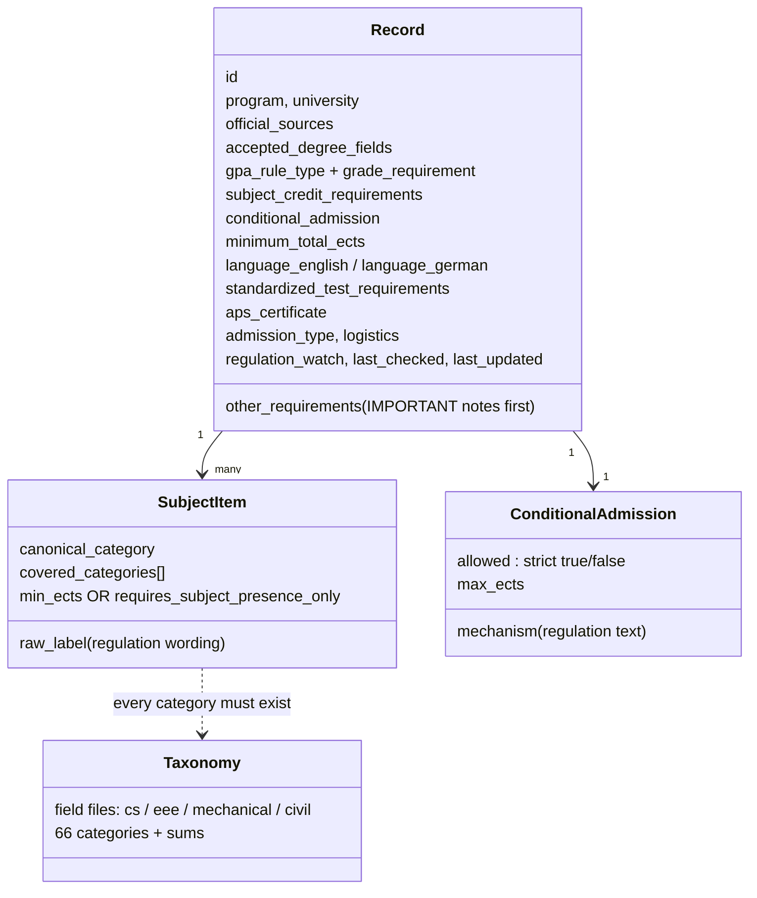

# Schema + validator — showcase (27.10.2026)

GPU-R stores 228 admission records rebuilt from official regulations. Before any record reaches the engine, a typed schema
(`gpur/schema.py`, Pydantic v2) and a validator (`scripts/validate_records.py`) check it. CI runs both on every push.

## The record format (v2)

What the checks enforce:
- **Shape:** fixed key order, no unknown keys (a typo is an error), every field typed.
- **Meaning:** a hard grade limit needs a value; IELTS only in half bands; a subject requirement needs ECTS or must be presence-only; every intake needs a deadline; record flags are strict true/false.
- **Consistency:** no duplicate ids; every category name exists in the approved taxonomy; each field taxonomy covers its records.
- **Integrity:** frozen files carry sha256 checksums in `MANIFEST.json`; any edit after freezing is caught.

## The validator catching real errors

Each row is a real run: one record of the CS file was broken on purpose, then the validator was run.

| # | Broken on purpose | Validator output |
|---|---|---|
| 1 | IELTS 6.3 (not a half band) | `ERROR GPU-R_computer_science_FROZEN_2026-10-24.json 9894: language_english.ielts_min: Value error, IELTS 6.3 is not a half band` |
| 2 | conditions allowed = "yes" (text, not true/false) | `ERROR GPU-R_computer_science_FROZEN_2026-10-24.json 9894: conditional_admission.allowed: Input should be a valid boolean` |
| 3 | category name that does not exist | `ERROR unknown category computer_science_informatics.web_development in 1 records, e.g. ['9894']` |
| 4 | two records with the same id | `ERROR 9894: duplicate id (GPU-R_computer_science_FROZEN_2026-10-24.json and GPU-R_computer_science_FROZEN_2026-10-24.json)` |
| 5 | fields in the wrong order | `ERROR GPU-R_computer_science_FROZEN_2026-10-24.json 9894: key order differs from format v2` |
| 6 | requirement with neither ECTS nor presence-only | `ERROR GPU-R_computer_science_FROZEN_2026-10-24.json 9894: subject_credit_requirements.items.0: Value error, item 'informatische Bezüge im Umfang von insgesamt mindestens 24 E' has no ECTS and is not presence-only` |
| 7 | file changed after freezing (checksum) | `ERROR checksum differs: GPU-R_computer_science_FROZEN_2026-10-24.json (file changed after the freeze)` |

## A gap the showcase itself found

Case 2 first **passed**: Pydantic quietly read the text `"yes"` as `true`, so a record saying conditions are allowed "yes"
would have been accepted. All record flags now use `StrictBool`, and two tests (`"yes"`, `"false"` as text) keep it fixed.
Lesson: test the validator with broken data, not only with good data.
